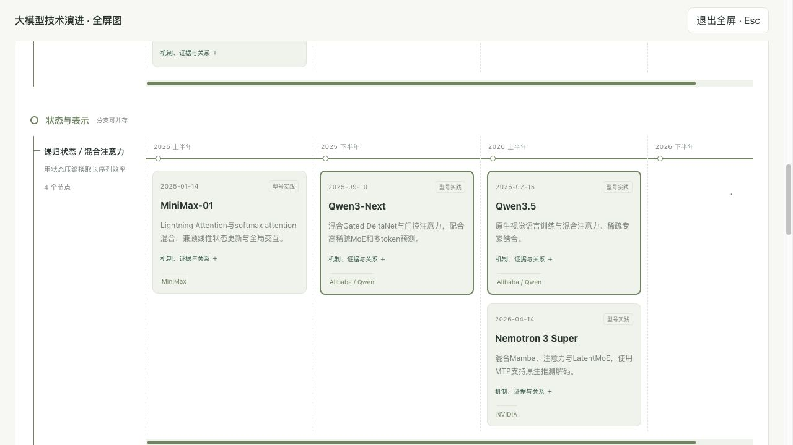
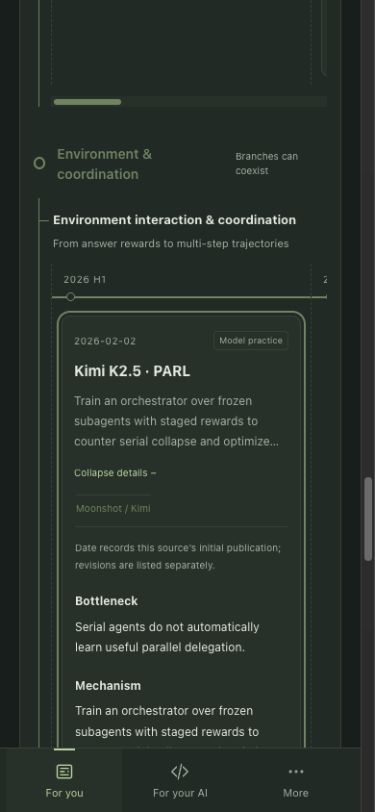

# 2026-10-22 大模型演进关系图验收

范围对应[REQ-25-9至13](../../FieldToFit-PM.md#req-25-9)。所有者先确认v1.15.0开发验证，随后明确授权更新并部署。本批同一未交付版本完成发布，不另行递增patch。

## 内容与兼容

27条路线、93个节点、43条类型化关系；Train 41节点、Inference 29节点、System 23节点，其中2025—2026分别18／10／7节点。保留原31个节点ID与18题完整正文、修订和本地记录键。单一目录向前端、服务端正文和只读JSON提供内容，schema_version保持1并追加字段。

原论文、技术报告、官方博客、型号资料和工程文档均可作为证据。优先核对首发日期与摘要／相关章节，不声称逐页复现全部论文实验。Qwen博客正文抓取存在空白，使用官方搜索摘要与官方型号资料交叉核对；不以可访问性代替论述核验。Kimi K3保留维护候选，未把尚未审阅完整报告的内容填入正式图。

修正MLA首发／V3采用、mHC年末首发／V4采用、AReaL首发／2026修订等日期；DeepEP仅采用官方引用中的2025年，不推断月份。不同关系有独立解释和来源，跨主线对照不声称公司实际部署。

## 自动验证

- 专题后端10项通过（最终复验0.95秒）：93节点双语／源引用、43关系端点与类型、首发／修订日期、31旧节点ID及18题完整正文哈希、逐节点SSR正文、只读API／ETag／权限、目录和旧入口。
- 其余相关后端48项通过（240.50秒）：首页预览、搜索页面、内容工作台。合计58项，无失败。
- 前端五组检查通过：evolution.cjs（读记录、修订、损坏／禁用存储、时间筛选、节点目标、公司绑定、KV单位）；evolution-map.cjs（实际React组件与本地化路由、冲突直链归一化、焦点／定位、有界渲染、全屏和收起状态）；reading-navigation.cjs、reading-position.cjs、for-you-navigation.cjs（既有导航和阅读位置）。
- 生产构建通过，专题分包约254.10KB／gzip77.78KB。既有主包超过500KB的警告仍在，未因本批扩展全站拆包范围；React测试工具有既有弃用提示。
- 版本同步确认1.15.0；仓库检查25项主REQ、196项子REQ，0错误；git diff --check通过。最终文档复验同样0错误（191份文档、1561个本地链接）。

本地浏览器发现并修复：本地化路由每次渲染返回新setter，若把它放进定位effect依赖，会反复重设状态并取消定位计时；改为依赖实际URL值并添加组件回归。长详情采用顶部定位和滚动边距，避免标题在视口之外；全屏退出栏固定可见。

## 浏览器验证

隔离预览监听127.0.0.1:8014，禁用dotenv，使用/tmp独立SQLite，Turso连接为空。最终版本重新启动预览，/api/health实际返回status=ok、version=v1.15.0；未连接生产数据。

| 场景 | 实际结果 |
| --- | --- |
| 中文桌面，全部历史／全部节点 | DOM显示93节点与3图，页面宽1265=视口宽1265；展开可见详情93项，收起后0项 |
| 全屏 | 模态打开、Esc退出、焦点返回按钮；节点开合与筛选保留，退出栏滚动时仍可见 |
| 冲突旧链接 | period=recent、view=key、track=systems、node=latent_kv-v3自动转为历史／全部／Inference；目标展开并聚焦，采用关系可跳到V2 |
| 英文窄屏 | 390×844视口设置下可用宽375（滚动条占位），页面宽375无溢出；卡宽249，8条所测路线在内部横向滚动 |
| 关系跳转 | Kimi K2.5 parallel agents→PARL从Inference切换到Train；目标展开、获焦，最终顶部约100px |
| 深浅色 | 中文桌面浅色与英文窄屏深色检查，公式／日期／来源与卡片可读；测试后恢复中文浅色和默认视口 |
| 公司高亮 | Alibaba仅高亮Qwen3 MoE、Qwen3-Next、Qwen3.5等绑定节点；保留其他公司的卡片 |
| 阅读记录 | 手动勾选T01→刷新仍已读→Train+Read组合筛选1项；键盘进入详情并返回原筛选地址。取消测试勾选后0/18；记录未被图更新清空 |
| 最终预览 | 恢复三图、近期重点30节点；对话框关闭，页面保留供所有者查看 |

目录链接的浏览器自动点击未稳定触发跳转，键盘Enter进入与返回已实际通过；未据此声称完成真实手机触控全流程。存储损坏、禁用与跨标签事件通过前端测试，本批未再次做真实双标签操作。

## 已知边界

图为筛选后的技术史，不声称穷尽所有论文／公司。2026覆盖至已核对资料；未披露闭源算法不推断。图中等宽时间带不是实际时长比例，年份精度的工程节点独立显示。关系在节点详情中按需查看，避免全图密集交叉线。重点与全部不会更改题目阅读记录。既有主包体积警告如上；正式直读验收见下节；线上浏览器连接超时，交互复验未完成。

## 2026-10-22 正式部署

发布前发现正式分支与站点已由并行批次升至v1.14.2（63ffa28），先快进合入，保留三份档案、绘图源、验收记录及全部正式资源；没有覆盖历史或再次发布旧内容。完整88表生产库只读备份88,506,368字节，独立SQLite完整性检查为ok，备份仅在私密忽略目录。

独立白名单目录包含375个应用文件、34,056,085字节；项目关联配置另随包，排除凭据、数据库、私密output、依赖、缓存和符号链接。初次正式部署ID为`dpl_CDJWGv5bmaqPyuyuzLoNNNPiW3xG`。部署期间旧版本仍服务，首次版本探测返回v1.14.2，未当作新版本通过。

- `/api/health`实际v1.15.0；三个MCP初始化版本均为1.15.0。
- 只读专题JSON与源码逐字段一致：27路线、93节点、43关系、18题；ETag条件请求304。
- 40个中英专题／目录／题目页面200且canonical唯一正确；93节点的瓶颈／机制／约束与43关系解释逐项出现于双语正文；18题核心正文保持。
- 中英首页顺序、既有maps／Codex入口、reading接口及更新日志正常；非法详情404、末尾斜杠308，站点地图包含全部40个入口。
- 部署前后动态219条、档案53份、报告15篇及模型快照逐字段对照保持（运行维护字段单列排除）；七张既有报告／信息卡图片哈希一致，当前JS／CSS资源可读取。无CMS写入、导入或数据库迁移。
- 合入后重新验证专题后端10项（0.86秒）、前端五组与生产构建通过；仓库192份文档、1564个本地链接、25项REQ／196子项，0错误。此前58项相关后端回归记录保持；本轮不把仅重跑10项写成重跑全部58项。

正式浏览器打开专题时连接超时并重置会话，没有取得生产页面截图或交互结果；本地中英桌面／窄屏证据仍单列，不冒充线上交互完成。

最终上线状态投影部署`dpl_4zdDvohCZtCVS6QG5A6q2TCZZaJN`已Ready并绑定正式域名；正式中英日志修订与源码完全一致（`a5f42dd1a027392a738f6d91cd20696e9b137df03cc9753aee66239b4c78f779`），v1.15.0为当前版、已核实的v1.14.2为已部署；health和完整专题JSON再次一致。最终包375个应用文件、34,056,105字节，应用代码／资源与前次已验包相同，仅更新发布状态投影。
