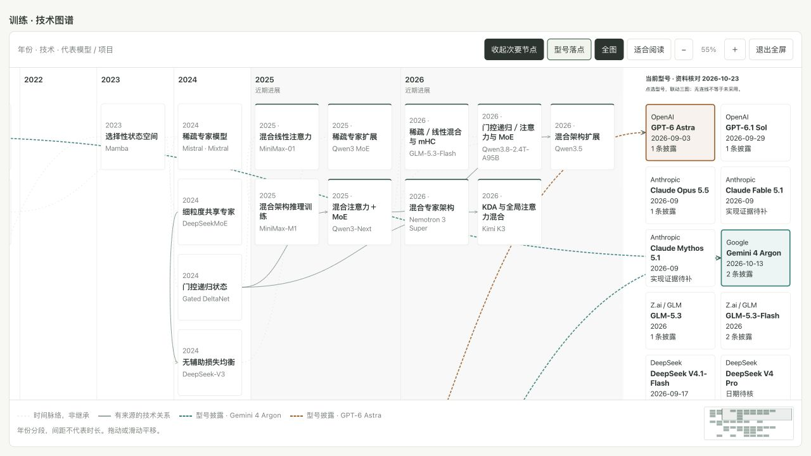
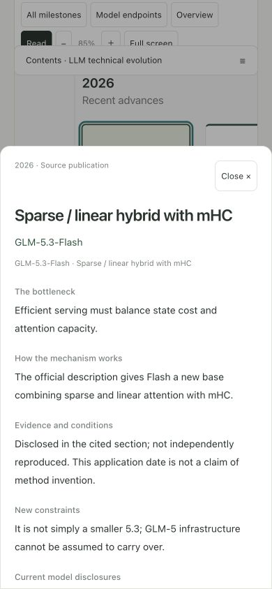

# 旗舰型号与三图技术路线：本地与正式验收

日期：2026-10-23—24。范围：REQ-25-21—26，所有者明确授权完成全部开发验证，已确认minor v1.17.0。开发阶段未推送或部署；所有者随后授权更新部署，并明确授权指定私密目录的完整本地备份。未修改生产数据库与凭据。

## 实现与内容边界

- 三张横向图保留定义、年代、分支、技术详情、缩放／平移／全屏／缩略导航。首页关键节点与完整页共用布局；关键／全部可原位切换。
- 15家公司25个型号／待核条目均在目录和三图末端出现；选择最多两型号，三图联动披露线，并比较共有技术身份与各自另外披露的内容。
- 105唯一技术节点，47技术关系，27型号披露。109个完整图节点呈现包括跨图投影，首页41个呈现；投影共享技术身份，DOM ID按图区分。
- 12家、15型号至少一条相关正文披露；其余明确记录缺口。资料覆盖不是所有旗舰身份确认，更不等于内部配方完整公开。
- 与HEAD v1.16.4逐项结构比较：旧93节点完整字段一致，原43关系全部保留，18题正文／修订一致。读记录键保持，无迁移。

## 自动验证

- `pytest tests/test_search_pages.py tests/test_llm_evolution.py tests/test_release_metadata.py -q`：48通过，189.61秒，包含搜索／SEO与全部40个双语专题页面。
- 同步v1.17.0、补充非法参数防护和最终目录说明后，专题与版本专项再次24通过，2.59秒。
- 六组前端脚本通过：evolution、evolution-map、evolution-home、reading-navigation、reading-position、for-you-navigation；覆盖节点布局、25端点、双型号证据比较、旧参数、跨图单侧详情、阅读记录和损坏／拒绝存储。
- 最终构建曾因新增 `Object.hasOwn` 不符合现有TypeScript目标而失败；改用 `hasOwnProperty.call`，不提高运行环境要求，随后重新构建和组件回归。
- 新增恶意或无效URL键 `constructor`／`__proto__`／`toString` 回归，避免对象原型属性被当作有效型号或节点。
- `npm run build`（TypeScript＋Vite）通过；已有主包约1.69MB的分块提示保留，不是新增构建错误。专题独立块约344KB。
- `release_metadata.py --write` 同步至1.17.0；`check_repository.py` 25主REQ／209子REQ、错误0；`git diff --check`通过。

## 浏览器实测

环境：独立临时SQLite公开预览，127.0.0.1:8027，禁用远端数据库及dotenv；IAB真实页面，非生产数据。前端生产构建由本地服务提供。

- 中文1280桌面，Argon与GPT-6 Astra两型号选择、三行对比、采用线、节点高亮；刷新保留型号参数。R1节点侧栏和来源可打开，无重复DOM ID。
- 英文390×844首页：三图75型号落点、41节点呈现；GLM-5.3 Flash节点打开底部详情，页面宽度不溢出，节点文字不溢出。
- 中文320×740完整页：比较表可横滑，109节点呈现；CSA-2底部详情可读，Esc关闭后焦点返回原节点。
- 18题目录→T01文章：勾选、刷新后文章保持已读，取消后返回目录；测试后恢复T01未读，既有S03已读保留。
- 最终构建补验：桌面全屏→型号落点→Esc退出，焦点返回全屏按钮；英文390首页节点→完整图谱，型号、节点与图区参数完整传递，底部详情再次展开。型号日期加入后无节点文字溢出。
- 页面控制台无error／warn。存储不可用、旧链接及布局边界由自动化组件测试覆盖；不声称浏览器实测了存储拒绝或真机触控／屏幕阅读器。

## 已知边界

闭源架构与生产执行细节未披露者不推断；Seed型号卡提取失败、Pangu精确旗舰及部分型号首发日保留待核。动态官网与README保留URL和核对日，未存不可变全文快照。真机设备和实体屏幕阅读器未验证；生产结果见下文。

## 界面证据

## 2026-10-24 正式部署

备份曾被自动审批拒绝，随后所有者明确授权把完整生产备份保存到指定本机私密目录并继续部署。实际88表、90771456字节，独立SQLite恢复完整性ok；备份不上传、不提交。正式白名单包408文件、38,581,774字节，项目关联另附，排除凭据、数据库、私密output、依赖和符号链接。

初次部署`dpl_MgzG9dvRj44oE4VzmFVD4oiT7iSC`实际Ready并绑定fieldtofit.top；2026-10-23T18:13:46.729256+00:00回读health与三项MCP均为v1.17.0／1.17.0。完整JSON与本地逐项一致，105节点／47技术关系／25条目／27披露；40双语专题页200且canonical唯一。首页41节点及全部型号可发现，ETag 304、sitemap、错误404与尾斜杠308通过；四个公开集合保持（仅排除维护运行字段），6张既有资源字节相同，当前JS／CSS可读取。

后续仅同步同版发布状态及站内日志，最终部署和源码发布结果另据真实回执补充。没有数据库迁移、CMS发布或精选内容轮替。

正式内置浏览器创建与重新绑定各超时一次，没有取得可靠的线上交互或截图；本地交互证据不冒充线上浏览器验收。正式HTTP／MCP成功与该浏览器限制分开记录。

最终状态同步部署 `dpl_5TigxBykRtDEzZXQWYEJkC9N3K4n` 已Ready并绑定fieldtofit.top；2026-10-23T18:18:34.888330+00:00再次读取health、完整目录及中英文日志成功，两语修订均与源码一致。最终白名单包408文件、38,581,784字节。源码发布采用非强制快进，标签`fieldtofit-v1.17.0`，不移动历史标签。
